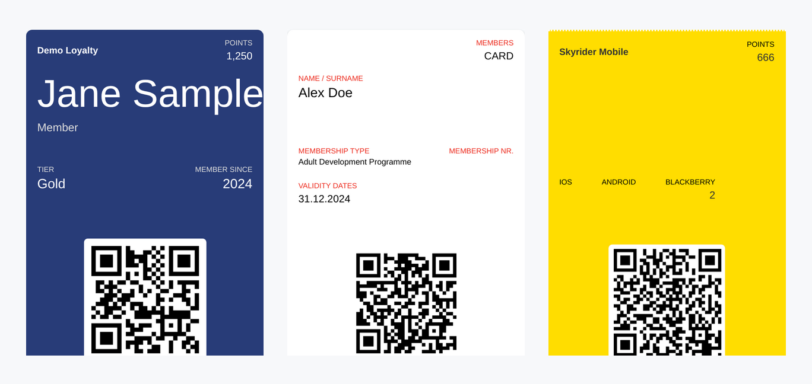

<div align="center">

# `@tiketo/pkpass-preview`

### See your Apple Wallet pass before you ship it.

iOS-faithful Apple Wallet pass previews for React.

[**Live Storybook →**](https://tiketocz.github.io/pkpass-preview/) &nbsp;·&nbsp;
[**npm**](https://www.npmjs.com/package/@tiketo/pkpass-preview) &nbsp;·&nbsp;
[**GitHub**](https://github.com/tiketocz/pkpass-preview)

[](https://www.npmjs.com/package/@tiketo/pkpass-preview)
[](https://www.npmjs.com/package/@tiketo/pkpass-preview)
[](https://github.com/tiketocz/pkpass-preview/blob/main/LICENSE)
[](https://tiketocz.github.io/pkpass-preview/)
[](https://tiketo.eu)

<a href="https://tiketocz.github.io/pkpass-preview/">
  
</a>

</div>

---

## Why `pkpass-preview`?

> GitHub search for `apple wallet pass preview` returns **zero** real components _(checked 2026-05-16)_. We checked.

Designing an Apple Wallet pass is a slow loop: edit `pass.json` → sign it → AirDrop to a phone → screenshot → adjust. By the time you spot the kerning issue, you've already wasted half a morning on the round-trip.

`pkpass-preview` renders the same JSON your signer pipeline consumes, **in the browser**, close to the way iOS Wallet does — so you can iterate on copy, fonts, colors, fields, and barcodes without ever leaving your editor.

- **Close-to-iOS rendering** — fonts, spacing, header/secondary/auxiliary layout, barcode placement, dark back side, transit icons (boarding passes). Not literal pixel-parity; honest visual fidelity that's good enough to design against.
- **Drop-in `<PKPassPreview values={...} />`** — pass the same `pass.json` + assets you'd zip up; nothing else to wire.
- **Auto-variant detection** — `id-card`, `store-card`, `boarding-pass`, `event-ticket`, `coupon`, and more, picked automatically from the field shape. Manual override available.
- **Scoped styles** — every instance gets its own unique container id; no global CSS, no portal, safe to render many cards on one page.
- **TypeScript-first**, **ESM-only**, **tree-shakeable**, **SSR-friendly** (wrap in `dynamic` import).

## Install

```sh
npm  install @tiketo/pkpass-preview
# or
pnpm add     @tiketo/pkpass-preview
# or
bun  add     @tiketo/pkpass-preview
```

Requires **React 18 or 19**.

## Quick start

```tsx
import { PKPassPreview } from "@tiketo/pkpass-preview";

const values = {
  "pass.json": {
    formatVersion: 1,
    passTypeIdentifier: "pass.com.example.coffee",
    teamIdentifier: "ABCDE12345",
    organizationName: "Brewbeat Coffee",
    description: "Loyalty card",
    backgroundColor: "rgb(28, 28, 30)",
    foregroundColor: "rgb(255, 255, 255)",
    storeCard: {
      primaryFields:   [{ key: "balance", label: "POINTS",  value: "420" }],
      secondaryFields: [{ key: "tier",    label: "TIER",    value: "Gold" }],
    },
  },
};

export default function PassPreview() {
  return <PKPassPreview values={values} />;
}
```

That's it. No theme provider, no portal, no global CSS — the component scopes its own styles via a unique container id.

[Open the live Storybook →](https://tiketocz.github.io/pkpass-preview/) for 40+ side-by-side examples covering every Apple-supported pass style.

## Features

|   |   |
|---|---|
| **All five pass styles** | `boardingPass`, `coupon`, `eventTicket`, `generic`, `storeCard`. |
| **Auto-variant detection** | id-card / store-card-3col / boarding-pass / coupon / event-ticket-strip and 10+ others, derived from field shape. Manual override available. |
| **Barcodes** | PDF417, QR, Code 128, Aztec — placement matches iOS (header, footer, strip-overlay). |
| **iOS 27 Featured Actions (experimental)** | Opt in with `targetOs="ios27"` to render up to two `featuredActions` tiles below the card. Default output is unchanged. The one- and two-tile layouts are based on native iOS 27.0 references (not pixel-perfect); the one-tile chevron is missing and unknown types remain a proposal. See [Target iOS version & Featured Actions](#target-ios-version--featured-actions-ios-27-experimental). |
| **Transit icons** | Airplane / train / bus / boat / generic, inline JSX SVG, `fill: currentColor` follows `labelColor`. |
| **Back fields** | Interactive in-card back-field view with link/separator treatment. Native Wallet's full Pass Details screen is a documented deviation. |
| **Scoped styles** | Unique container id per instance — no global CSS, no portal, safe to render many cards on one page. |
| **Content Security Policy** | The component emits scoped inline `<style>` content and some `style` attributes, so `style-src 'self'` alone blocks its presentation. See [CSP](#content-security-policy-csp). |
| **SSR-friendly** | Client-only; wrap in `next/dynamic({ ssr: false })` or render inside a client component. |
| **TypeScript-first, ESM-only** | Strict types, tree-shakeable, zero runtime dependencies in the public API surface. |

## Poster generic previews (experimental)

`PKPassPreview` accepts an optional `variant` prop for passes that contain the
iOS 27 `posterGeneric` structure:

```tsx
<PKPassPreview values={values} variant="poster" />
<PKPassPreview values={values} variant="fallback" />
```

- `variant="poster"` renders the experimental iOS 27 full-bleed artwork layout.
  If `posterGeneric` is absent, the renderer falls back to the pass's classic
  structure.
- `variant="fallback"` always renders the classic structure (for example,
  `generic`) even when `posterGeneric` is present.
- Omitting `variant` preserves the existing classic rendering behaviour.

The initial poster renderer covers the full-bleed `artwork` image, logo and
header, centered barcode, all primary fields in one responsive bottom-band row,
and footer fields. It is intended for previewing and is not yet a pixel-perfect
implementation of every iOS 27 poster size or feature.

## Target iOS version & Featured Actions (iOS 27, experimental)

`PKPassPreview` accepts an optional `targetOs` prop that says which iOS release
the preview emulates for capability-gated features. It is independent of
`variant`: `variant` chooses the layout (poster vs classic), `targetOs` chooses
which iOS features are shown.

```tsx
<PKPassPreview values={values} targetOs="ios27" />
<PKPassPreview values={values} targetOs="ios27" variant="poster" />
```

| `targetOs`           | Featured Actions                                       |
| -------------------- | ------------------------------------------------------ |
| omitted (default)    | not rendered: output identical to previous releases    |
| `"ios26"`            | not rendered (Wallet before iOS 27 ignores them)       |
| `"ios27"`            | up to two tiles rendered below the card front           |

With `targetOs="ios27"`, the top-level `featuredActions` array of `pass.json`
(schema per apple/pass-builder `Pass+Action.swift`: `identifier` required and
unique, `type` required, `url` optional) is rendered as a row of up to two
white rounded tiles directly below the card front, in input order. This works
for every pass style, including `generic` and `eventTicket`. Each tile has a
green circle icon (top left), a bold label and a grey "Open Link" subtitle:

| `type`         | Icon (white glyph on iOS green `#34C759`) | Label            | Subtitle    | Status                 |
| -------------- | ----------------------------------------- | ---------------- | ----------- | ---------------------- |
| `addToBalance` | credit card                               | "Add to Balance" | "Open Link" | native reference       |
| `call`         | phone handset                             | "Call"           | "Open Link" | native reference       |
| anything else  | arrow                                     | "Open"           | "Open Link" | proposal (unverified)  |

Invalid input never throws. The rules are exported as `resolveFeaturedActions(featuredActions, targetOs)`:

- A non-array value (missing, `null`, object, …) means no actions.
- Entries that are not plain objects, or have a missing or blank `identifier`
  or `type`, or have a non-string `url`, are skipped.
- A later entry that repeats an `identifier` is skipped.
- Unknown `type` values are kept and rendered as a generic tile with the label
  "Open" and an arrow icon.
- Only the first two valid entries are rendered. Zero valid entries means no
  tile container at all.

> **Native reference vs proposal.** The two-tile row for `addToBalance` +
> `call` (tile proportions, green icons, labels, "Open Link" subtitle) is
> aligned to native Apple Wallet iOS 27.0 (24A434) on an iPhone 17 Pro
> Simulator, for both `generic` and `eventTicket`. It is an approximation,
> not pixel-perfect (web fonts, glyph shapes, shadow). Still a **proposal**
> without native reference: the unknown-type tile ("Open" + arrow) and the
> single-action tile's missing grey chevron.
> The preview is static: tiles are not links, and `url` is only exposed via
> `title` / `data-url`.

New exports: types `FeaturedAction`, `KnownFeaturedActionType`,
`PreviewTargetOs` and `ResolvedFeaturedAction`, plus `resolveFeaturedActions`,
`supportsFeaturedActions`, `MAX_FEATURED_ACTIONS`, `FEATURED_ACTION_LABELS`,
`FEATURED_ACTION_SUBTITLE` and `UNKNOWN_FEATURED_ACTION_LABEL`.

## Compatibility

| Layer | Versions |
|---|---|
| React | `^18.0.0` (incl. 18.3) — `^19.0.0` |
| Browsers | Modern evergreen (Chrome, Safari, Firefox, Edge) — ES2022 |
| Pass spec | [Apple Wallet Developer Guide](https://developer.apple.com/documentation/walletpasses) — `formatVersion: 1` |
| iOS reference | Recorded per Storybook scenario. Recent signed references use iOS 26.5/27.0; unversioned legacy captures are labelled as such. |

Server-side rendering (Next.js App Router, Remix, Astro): the component is client-only. Wrap in `next/dynamic` with `ssr: false`, or render inside a client component.

## Content Security Policy (CSP)

`PKPassPreview` does **not** currently support a strict `style-src 'self'` policy by itself. Each instance emits a scoped inline `<style>` element, and some layouts use inline `style` attributes for dynamic artwork and field geometry. Consumers must permit inline styles, typically with:

```http
Content-Security-Policy: style-src 'self' 'unsafe-inline'
```

There is no public nonce prop or built-in external-stylesheet mode. A fixed hash is not a general workaround because generated CSS contains a per-instance identifier and dynamic asset/layout values; style attributes also require separate CSP handling. Scripts do not require `unsafe-inline` from this component.

## Known differences from Apple Wallet

- A single iOS 27 Featured Action has the native width and content, but the web tile is missing Wallet's grey right-side chevron. Unknown action types remain an unverified proposal.
- The component's back-field interaction is an in-card view; native iOS 27 uses a full Pass Details screen with additional Wallet controls. Storybook compares both honestly and does not imitate those controls.
- Poster Generic can differ in browser font metrics, exact truncation, raster scaling, and dense bottom-band shading.
- iOS 26.5 compatibility is explicit: it ignores Featured Actions and uses the classic Generic fallback. Unversioned legacy references remain labelled “origin not recorded.”

See the [Storybook known-deviations page](https://tiketocz.github.io/pkpass-preview/?path=/story/developer-guide--known-deviations) for references and status.

## Comparison

| Project | What it does | What it isn't |
|---|---|---|
| **`@tiketo/pkpass-preview`** | **Renders** a `.pkpass` payload in the browser for visual review. | Doesn't sign, doesn't bundle, doesn't push to Apple. |
| [`passkit-generator`](https://github.com/alexandercerutti/passkit-generator) | Node-side **builder + signer** producing a real `.pkpass`. | No browser preview, no React. |
| [Apple PassKit Web Service](https://developer.apple.com/documentation/walletpasses) | Apple's **push/update protocol** for installed passes. | Not a preview tool. |
| [Pass Designer (commercial SaaS)](https://www.passdesigner.io/) | Drag-and-drop **GUI designer**. | Closed source, not embeddable in your app. |

If you're building a **dashboard, designer UI, CMS, or test harness** that needs a faithful Wallet preview without round-tripping through an iPhone, this is the missing piece.

> **Pair `pkpass-preview` (design-time) with [`passkit-generator`](https://github.com/alexandercerutti/passkit-generator) (build-time)** for a full pipeline — preview while you design, sign when you ship.

## FAQ

<details><summary><b>Does it work with Next.js / Remix / Astro?</b></summary>

Yes — ESM-only, no CJS pitfalls. The component itself is client-only (it measures DOM); wrap in `next/dynamic({ ssr: false })` (App Router) or render inside a client component.
</details>

<details><summary><b>Does it sign the pass or push updates?</b></summary>

No. It's a **renderer**, not a generator. Pair it with [`passkit-generator`](https://github.com/alexandercerutti/passkit-generator) (Node) or any signing service you run; we ship a sibling private service at `tiketocz/pkpass-signer` for our own pipeline.
</details>

<details><summary><b>Is it CSP-safe?</b></summary>

Not under `style-src 'self'` alone. The component emits scoped inline `<style>` content and dynamic style attributes, so consumers currently need `style-src 'unsafe-inline'`. There is no nonce prop or external-stylesheet mode; see [Content Security Policy](#content-security-policy-csp).
</details>

<details><summary><b>What pass version / format does it support?</b></summary>

Apple's `formatVersion: 1` schema, all five pass styles, and every documented field (`primary` / `secondary` / `auxiliary` / `header` / `back`). Personalization passes (`nfc` field) render visually but the NFC interaction itself is iOS-only.
</details>

<details><summary><b>How are the iOS reference screenshots produced?</b></summary>

A real `.pkpass` is generated, opened in Wallet or its add-pass flow, screenshotted, and committed to `packages/storybook/public/screenshots/`. Recorded simulator/device/iOS provenance is shown per Storybook scenario; older captures whose provenance was not recorded remain explicitly labelled as legacy rather than guessed.
</details>

<details><summary><b>Why React only? What about Vue / Svelte / Solid?</b></summary>

The component ships as ESM React 18+. Framework-agnostic primitives (a headless rendering core that any UI library can wrap) are on the roadmap if there's demand — [open an issue](https://github.com/tiketocz/pkpass-preview/issues/new) and tell us your stack.
</details>

<details><summary><b>Is this affiliated with Apple?</b></summary>

No. "Apple Wallet" and "PassKit" are trademarks of Apple Inc. This project is an independent open-source renderer that consumes the public `.pkpass` schema. We are not affiliated with, endorsed by, or sponsored by Apple.
</details>

## Roadmap

- [x] All five Apple pass styles, side-by-side with iOS
- [x] Auto-variant detection (`deriveVariant(values)`)
- [x] Inline transit icons (boarding passes)
- [x] `npm` publish via OIDC trusted publisher
- [x] Per-PR Storybook previews on GitHub Pages
- [ ] Visual regression CI gate (Playwright + pixelmatch, info-only → blocking)
- [ ] Public-facing typedoc / docs site
- [ ] Google Wallet pass previews (sibling component)
- [ ] iOS 27 Create-a-Pass support, when it lands

## Contributing

Contributions welcome — especially **new fixture brands**. Each invented brand you add becomes another visual proof point in the gallery; it's the highest-impact, lowest-friction way to help.

To add a fixture:

1. Drop a `values` object into `packages/storybook/src/fixtures/<your-brand>.ts`.
2. Add a story in the matching `*.stories.tsx`.
3. (Optional) Install the pass on an iPhone and add an iOS screenshot to `packages/storybook/public/screenshots/<your-brand>.jpg` for side-by-side.
4. Open a PR — the per-PR Storybook preview will render your fixture automatically.

For component changes, see the dev setup below.

### Local dev

```sh
bun install
bun run lint
bun run typecheck
bun run test
bun --filter @tiketo/pkpass-preview-storybook dev   # Storybook on http://localhost:6006
```

### Releasing

Tag-driven, OIDC-published. Bump the version in `packages/preview/package.json`, push a matching `v*` tag, the `release.yml` workflow does the rest. No static `NPM_TOKEN`.

## Resources

- [Apple Wallet Developer Guide](https://developer.apple.com/documentation/walletpasses) — the `.pkpass` spec
- [iOS Human Interface Guidelines · Wallet](https://developer.apple.com/design/human-interface-guidelines/wallet) — Apple's design intent
- [`.pkpass` file format reference](https://developer.apple.com/library/archive/documentation/UserExperience/Reference/PassKit_Bundle/Chapters/Introduction.html)
- [Live Storybook gallery](https://tiketocz.github.io/pkpass-preview/)
- [`tiketocz/pkpass-builder-ui`](https://github.com/tiketocz/pkpass-builder-ui) — the archived private predecessor

## License

[MIT](https://github.com/tiketocz/pkpass-preview/blob/main/LICENSE) — do whatever you want, just don't sue us.

---

<div align="center">

Built by **[tiketo](https://tiketo.eu)** — an Apple &amp; Google Wallet pass platform.<br/>
We use this component in production at **[get.tiketo.eu](https://get.tiketo.eu)**.

</div>
